# Grocery Ordering App — Technical Overview

*A visual walkthrough of the application (frontend screens) and how information moves through it.*

> **Please read first.** This app is **self‑contained**: it runs on a phone (or in a web browser) and does **not** talk to any outside server, website, database, or artificial‑intelligence service. Everything it needs to work lives **inside the app itself**.
>
> Normally an app has a "backend" — a separate computer on the internet that stores data and does the heavy lifting. This app doesn't. Instead, it has a small **"engine" built into the app** that plays that role: it remembers your data, does the calculations (like cart totals), and even *pretends* a delivery is on its way. The sections below explain that built‑in engine in plain language. Everything shown is real and taken from the actual code — nothing has been made up.

---

## 1. Application Overview

A grocery ordering app for **vegetables & fruits** with two roles:

- **Customer** — browse/search products, build a custom package, add to cart, checkout, and watch **simulated live delivery tracking**.
- **Admin** — an analytics dashboard plus CRUD management of products, packages and orders. Admin order/delivery‑status changes flow **live** to the customer's tracking screen through shared state.

**Stack:** React Native 0.81 · Expo SDK 54 · TypeScript · React Navigation (drawer + native stack) · `react-native-chart-kit` / `react-native-svg` for analytics · AsyncStorage for persistence.

---

## 2. Frontend Screens

*All images below are real screenshots captured from the app running locally via `npx expo start --web`.*

### Customer experience

| Screen | What it does |
|---|---|
| 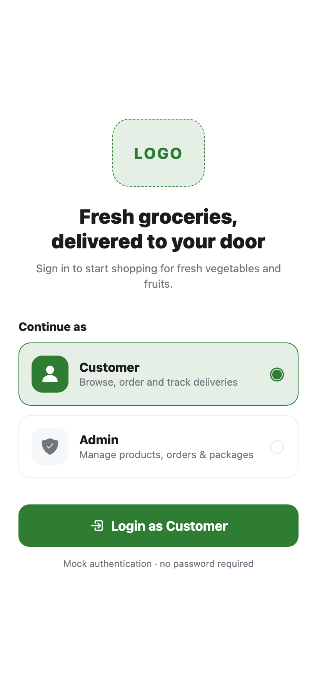 | **Login** — mock, password‑less auth. Pick **Customer** or **Admin** to enter the matching experience. |
| 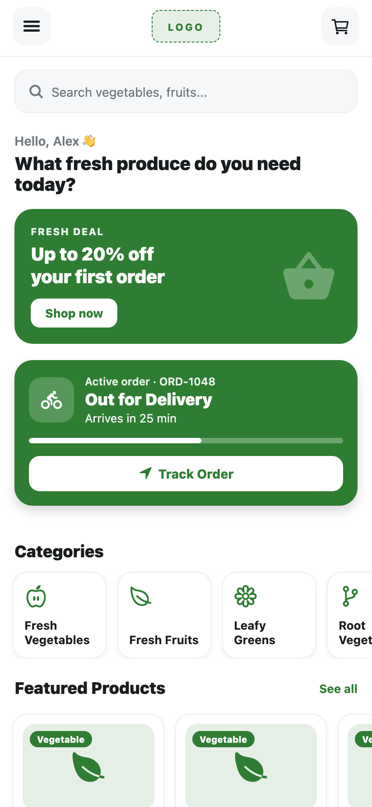 | **Home** — search bar, promo banner, a **live active‑order card** with progress + "Track Order", category shortcuts and featured products. |
| 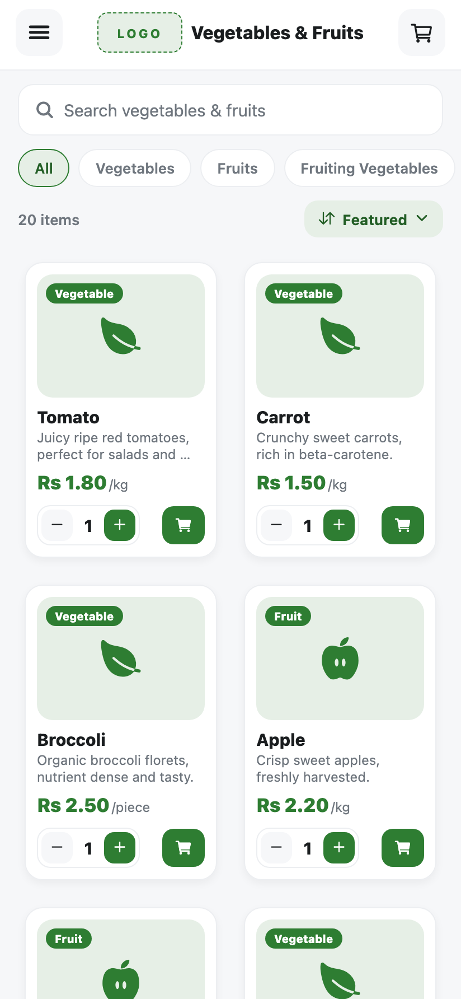 | **Vegetables & Fruits** — searchable, category‑filtered, sortable product grid with inline quantity + add‑to‑cart. |
| 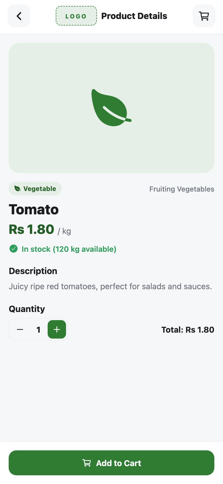 | **Product Details** — image, price/unit, stock status, description, quantity selector and running total, with **Add to Cart**. |
| 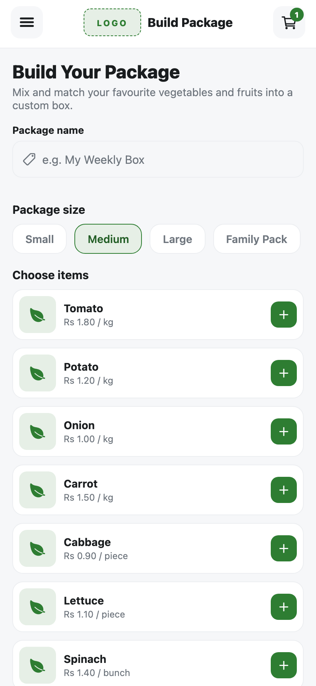 | **Build Your Package** — compose a custom box (name + size + chosen items with quantities) as a single cart line. |
| 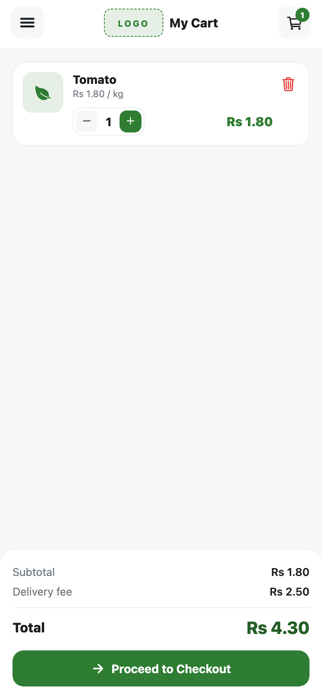 | **My Cart** — line items with quantity controls, subtotal, fixed delivery fee and total, then **Proceed to Checkout**. |
| 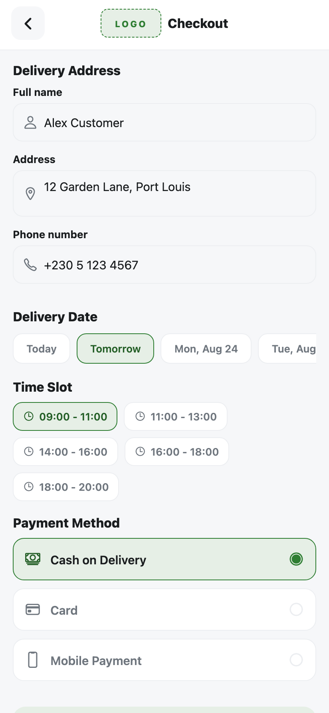 | **Checkout** — delivery address/phone, delivery date, time slot and payment method; validates required fields before placing the order. |
| 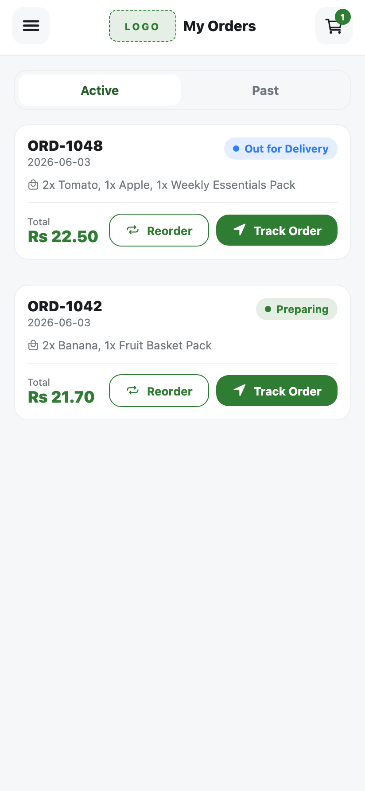 | **My Orders** — Active vs Past tabs with order summary, **Reorder** and **Track Order**. |
| 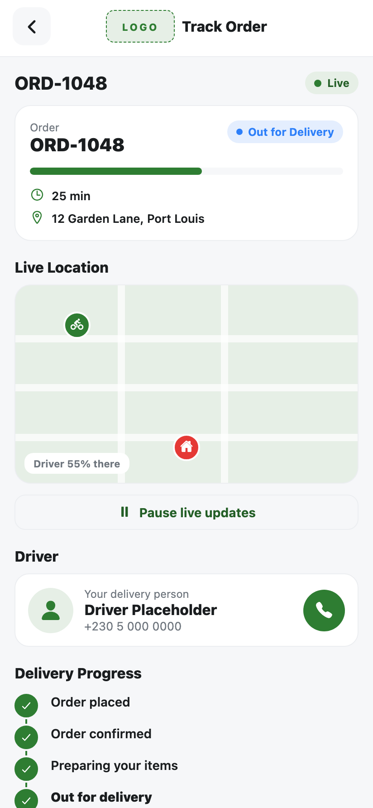 | **Delivery Tracking** — live status, map‑style view with a moving driver marker, progress %, ETA, driver info and an auto‑advancing timeline (pause/resume). |
| 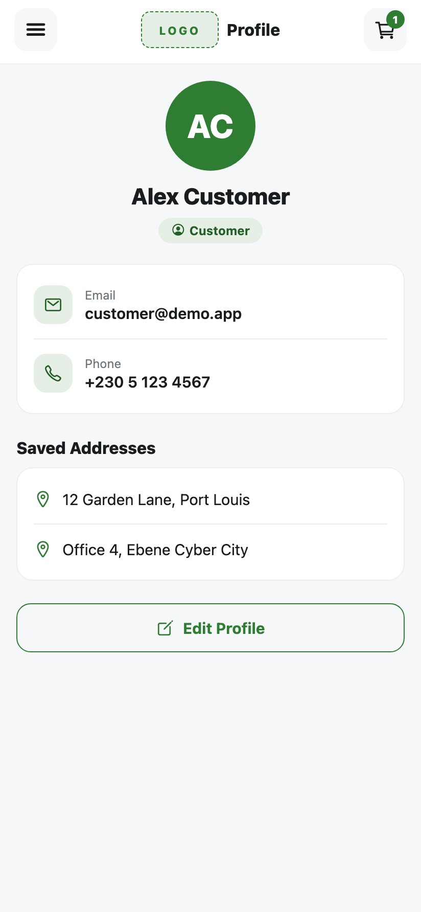 | **Profile** — editable customer details and saved addresses. |
| 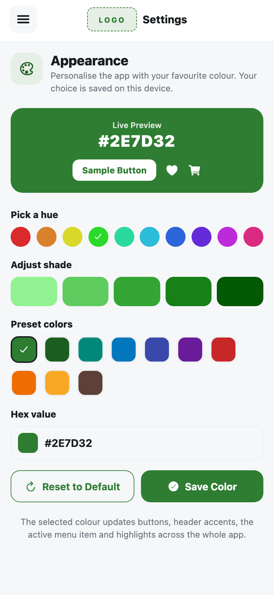 | **Settings** — pick any app colour (hue/shade/preset/hex) with live preview; persisted on device and applied app‑wide. |

### Admin experience

| Screen | What it does |
|---|---|
| 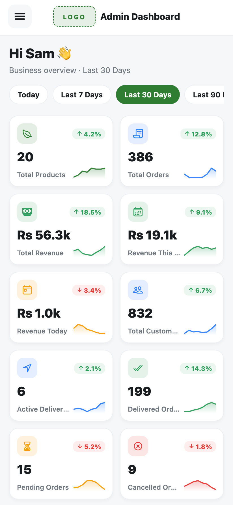 | **Admin Dashboard** — business‑intelligence panel: 12 KPI cards with trend + sparkline and a date‑range filter driving the charts below. |
| 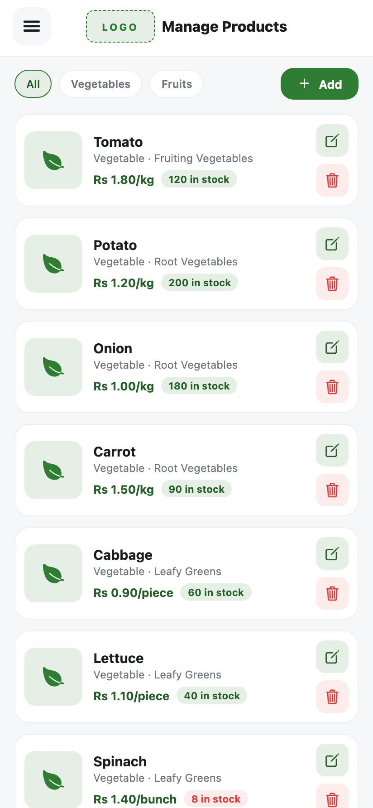 | **Manage Products** — list with category filter, stock badges, and add / edit / delete. |
| 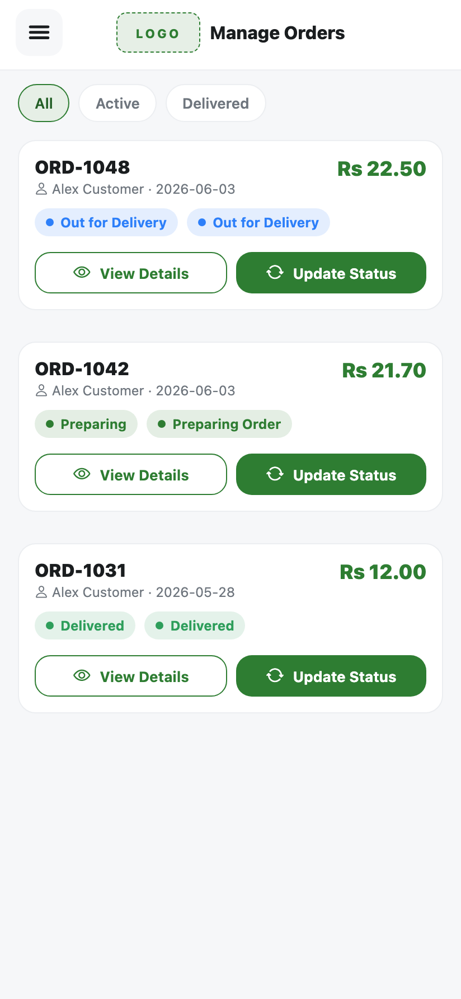 | **Manage Orders** — all orders with status chips, filter tabs, and quick status updates. |
| 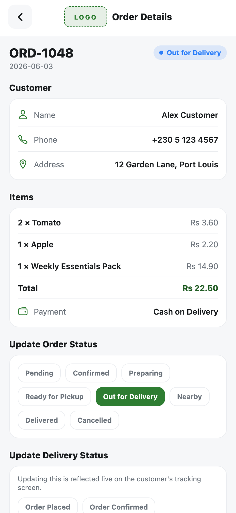 | **Order Details** — full order + item breakdown, and controls to **Update Order Status / Update Delivery Status** (reflected live on the customer's tracking screen). |
| 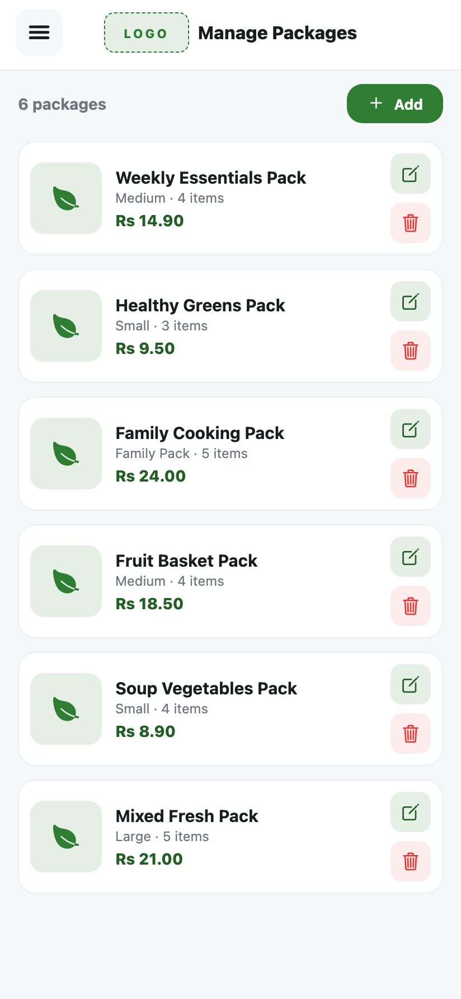 | **Manage Packages** — ready‑made packages with size/item counts and add / edit / delete. |

---

## 3. How the App Works Behind the Scenes

Think of the app as a **small shop that keeps everything in its own back room** — there is no separate warehouse or head office on the internet. When you tap a button, the request never leaves your device; the app's own built‑in "engine" handles it and updates the screen.

### A simple picture

```text
        ┌──────────────────────────────────────────────────────┐
        │  1. WHAT YOU SEE  (the screens & buttons)             │
        │     Home · Products · Cart · Checkout · Tracking ·    │
        │     Admin dashboard, etc.                             │
        └───────────────────────┬──────────────────────────────┘
                                 │  you tap a button
                                 ▼
        ┌──────────────────────────────────────────────────────┐
        │  2. THE FRONT DESK  (receives every request)          │
        │     Decides what you asked for: log in, add to cart,  │
        │     place an order, update a status…                  │
        └───────────────────────┬──────────────────────────────┘
                                 │  hands it to the right helper
                                 ▼
        ┌──────────────────────────────────────────────────────┐
        │  3. THE ENGINE ROOM  (does the thinking)              │
        │     • Checks who you are (Customer or Admin)          │
        │     • Adds up cart totals & delivery fee              │
        │     • Works out delivery progress %                   │
        │     • An automatic timer that "moves" the delivery    │
        └───────────────────────┬──────────────────────────────┘
                                 │  reads / writes information
                                 ▼
        ┌──────────────────────────────────────────────────────┐
        │  4. THE MEMORY  (where information is kept)            │
        │     • A shared "noticeboard" every screen can read    │
        │       (products, orders, packages, your cart)         │
        │     • A small notebook saved on your device so your   │
        │       login, cart and chosen colour survive a restart │
        └───────────────────────┬──────────────────────────────┘
                                 │  information changed
                                 ▼
        ┌──────────────────────────────────────────────────────┐
        │  5. THE SCREEN UPDATES automatically                  │
        │     Everyone looking at that information sees the      │
        │     new value straight away.                          │
        └──────────────────────────────────────────────────────┘
```

### What each part means (in everyday words)

| Part of the app | Plain‑English meaning | Real‑world comparison |
|---|---|---|
| **The screens** | The pages and buttons you interact with. | The shop floor. |
| **The front desk** | Catches your tap and figures out what you want. | A receptionist taking your request. |
| **The engine room** | Does calculations and decisions (totals, who can see what, delivery progress). | The staff in the back room. |
| **Login check** | Confirms whether you're a Customer or an Admin and shows the right screens. | A name badge that unlocks certain doors. |
| **The automatic timer** | Every few seconds it nudges a delivery one step further along, all by itself. | A stopwatch that keeps the delivery "moving". |
| **The shared noticeboard** | One central place that holds products, orders and your cart, which every screen reads from. | A whiteboard everyone in the shop can see. |
| **The device notebook** | A tiny bit of storage on your phone so some things aren't forgotten when you close the app. | A sticky note left on the fridge. |

### Good to know

- **Nothing is sent over the internet.** No accounts, passwords, payments or personal data leave your device.
- **What is remembered vs. reset.** Your **login**, your **cart**, and your **chosen app colour** are saved on the device and survive a restart. The **product and order lists** start fresh from built‑in sample data each time the app is fully reloaded.
- **Photos** you attach to a product (Admin) stay on the device only — they are not uploaded anywhere.
- **Not included** (because the app doesn't need them): an internet server, an online database, payment processing, or any AI service.

---

## 4. The Most Important Journeys, Step by Step

These are the app's key features shown as simple, top‑to‑bottom journeys.

### Journey A — Logging in

```text
You tap "Login as Customer" (or Admin)
        ↓
The app checks which role you picked
        ↓
It remembers you on the device (so you stay logged in)
        ↓
It opens the right set of screens:
   Customer  →  shopping & tracking
   Admin     →  dashboard & management
```

### Journey B — Placing an order

```text
You fill in the Checkout form
(name, address, phone, delivery day, time slot, payment)
        ↓
The app checks the important fields are filled in
        │
        ├─ something missing → it shows a friendly error and stops
        │
        └─ all good ↓
The app creates your order (with an order number)
and empties your cart
        ↓
You see the "Order Confirmed" screen
        ↓
Your new order now appears in "My Orders" and can be tracked
```

### Journey C — Live delivery tracking (runs by itself)

```text
You open "Track Order"
        ↓
An automatic timer starts and, every few seconds…
        ↓
it moves the delivery to the next stage
(Order Placed → Confirmed → Preparing → Ready →
 Out for Delivery → Nearby → Delivered)
        ↓
On screen you see the driver icon move closer,
the progress bar fill up, and each step get ticked off
        ↓
It stops when the order is "Delivered"
(you can Pause or Resume at any time)
```

### Journey D — Admin update shows up instantly for the customer

```text
Admin opens an order and changes its delivery status
        ↓
The change is written to the shared "noticeboard"
        ↓
Because the customer's tracking screen reads from
the very same noticeboard…
        ↓
the customer sees the new status right away —
no refresh, no waiting
```

---

## How to run it

```bash
npm install
npx expo start --web     # or press a / i for Android / iOS, or scan the QR in Expo Go
```

Log in as **Customer** or **Admin** (no password). Use **Logout** in the side menu to switch roles.
